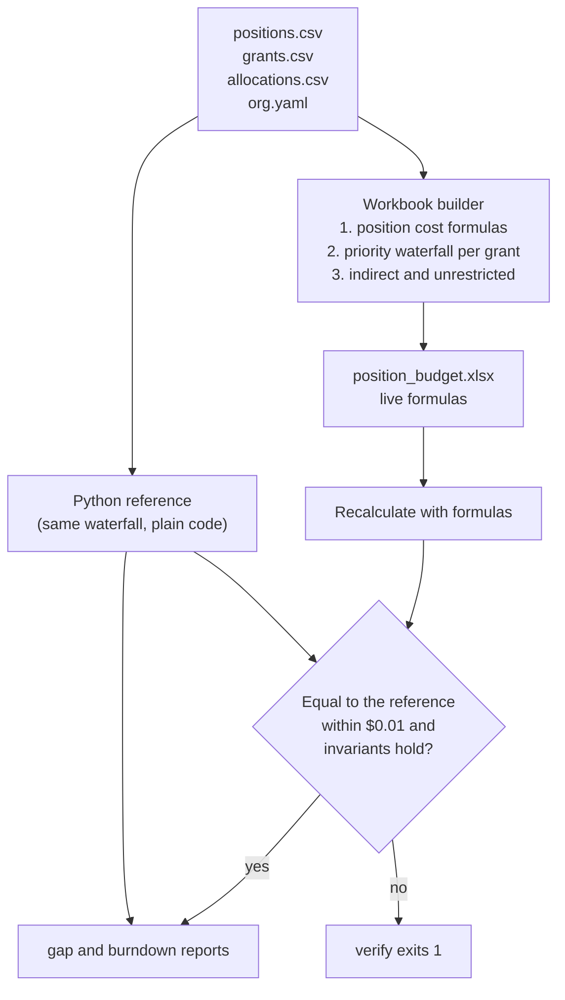

# grantcap

[](https://github.com/SlateGitOrg/grantcap/actions/workflows/ci.yml)


grantcap builds a nonprofit's annual position budget as an Excel workbook of live formulas in which each salary is charged to a restricted grant only while the grant's period is open and its award has money left. Whatever a grant cannot carry falls to unrestricted funds, and indirect cost is recovered at the lower of the negotiated rate and the funder's cap, so the unrestricted gap for every month and program is computed in the workbook instead of being discovered at year end. A plain-Python reference runs the same waterfall, and `grantcap verify` recalculates the workbook and compares it with that reference to the cent.

All data in this repository is synthetic: a seeded generator produces a fictional youth and family services organisation with 48 positions, 7 grants and a handful of deliberately injected problems.

## The problem

A position budget is usually a spreadsheet in which someone types a percentage of each salary against each grant. Three things go wrong quietly:

- A grant's period ends in March, or its award is used up in May, but the percentages still say 100%, so salaries keep being "charged" to money that is not there.
- Indirect cost recovery is assumed at the full negotiated rate, although a foundation caps it at 10%, the state at 15% and the county at 0%.
- The gap that unrestricted donations must fill is only visible when the books close.

grantcap treats the allocation as a capacity-constrained waterfall. For every grant, month by month, rows are charged in order. A row's direct charge is the in-period flag times the smaller of its requested dollars and what is left of the award, after every earlier charge to that grant including indirect, divided by 1 + the effective indirect rate. The awards are those a funder would enforce, so the board's number is computed under the same rules.

## How it works



The workbook has eight sheets:

| Sheet | Content |
|---|---|
| `Inputs` | Fringe rate, negotiated indirect rate, fiscal year and its 12 month boundaries |
| `Positions` | Monthly cost = salary / 12 x FTE x merit factor from the effective month x (1 + fringe), zero before the hire month |
| `Grants` | Award, period, cap, effective indirect rate = MIN(negotiated, cap), and an in-period flag per month |
| `Charges` | One row per position-grant allocation, grouped by grant in priority order, one direct-charge formula per month |
| `Indirect` | Direct charges, indirect recovered and indirect under-recovery per grant and month |
| `Unrestricted` | Cost less grant charges per position-month, then direct shortfall and under-recovery by program |
| `Summary` | Gap by month and program, grant burn-down, exhaustion month and unspent balance per grant |
| `Checks` | Funding identity per month, awards not exceeded, no charges outside a period, reconciliations |

Only these functions appear in formulas: `SUM`, `SUMPRODUCT`, `IF`, `MIN`, `MAX`, `ROUND`, `INDEX`, `MATCH`, `AND`. A test enforces the list. Grant blocks on `Charges` are contiguous, so "everything charged to this grant so far" is a plain `SUM` over a range. The default dataset produces about 3,300 formula cells.

## Quick start

```bash
python -m venv .venv && source .venv/bin/activate
pip install -e ".[dev]"

grantcap generate --out data            # synthetic inputs and truth.json (already committed)
grantcap build --data data --out out/position_budget.xlsx
grantcap verify --data data --workbook out/position_budget.xlsx
grantcap gap --data data
grantcap burndown --data data

# Extend grant G05 with a renewal award and see the gap close
grantcap gap --data data --renew G05 --amount 90000
```

`gap` and `burndown` take `--csv-dir out/` to also write the tables as CSV. `--renew` and `--amount` work on `build`, `verify`, `gap` and `burndown`; the renewal adds the amount to the award and extends the period to the fiscal year end (or `--through YYYY-MM-DD`).

Input files:

| File | Columns |
|---|---|
| `positions.csv` | `id, program, title, annual_salary, fte, hire_month, merit_pct, merit_month` (blank hire month = filled from month 1, blank merit month = no increase) |
| `grants.csv` | `id, name, funder_type, award, period_start, period_end, indirect_rate_cap, priority` (award covers direct plus indirect) |
| `allocations.csv` | `position_id, grant_id, requested_pct` (row order inside a grant is the charge order) |
| `org.yaml` | `fiscal_year_start`, `fringe_rate`, `negotiated_indirect_rate` |

## Example output

`grantcap verify` after `grantcap build`:

```
Compared 3284 formula cells with the reference (Positions 588, Grants 91, Charges 1360, Indirect 309, Unrestricted 720, Summary 216).
Largest difference: $0.0000
Checks sheet: PASS
OK: workbook matches the reference.
```

`grantcap gap` (first table; the command also prints the gap by program and the ten positions carrying most of it):

```
Unrestricted gap by month, fiscal year starting 2025 (US dollars)

Month   Direct shortfall  Indirect under-recovery      Total
------  ----------------  -----------------------  ---------
Jul-25           104,026                    8,422    112,449
Aug-25           104,026                    8,422    112,449
Sep-25           104,026                    8,494    112,520
Oct-25            47,013                    8,494     55,506
Nov-25            47,013                    8,843     55,856
Dec-25            47,013                    8,843     55,856
Jan-26            48,423                    9,108     57,531
Feb-26            48,423                   10,266     58,689
Mar-26            82,354                    9,248     91,602
Apr-26           129,269                    6,808    136,077
May-26           129,269                    6,808    136,077
Jun-26           129,269                    6,808    136,077
Year           1,020,123                  100,565  1,120,688
```

July to September is high because the federal award year of G02 starts on 1 October and only part of its positions are carried by the previous year's award (G01). March steps up because G03 runs out that month, and April to June are the highest because G03 stays exhausted and G05 ended on 31 March.

`grantcap burndown`:

```
Grant  Funder        Award  Charged  Exhaustion month  Unspent
-----  ----------  -------  -------  ----------------  -------
G01    federal      77,000   73,990                 -    3,010
G02    federal     900,000  861,197                 -   38,803
G03    state       513,000  513,000        9 (Mar-26)        -
G04    foundation   60,000   56,236                 -    3,764
G05    foundation  242,000  237,228                 -    4,772
G06    state       514,000  458,863                 -   55,137
G07    county      308,500  299,274                 -    9,226
```

`grantcap gap --renew G05 --amount 90000` lowers April to June to 104,832 of direct shortfall per month (from 129,269) and raises indirect under-recovery to 8,763 (from 6,808), because the foundation recovers only 10% of the 18% negotiated rate. The fiscal year gap falls from 1,120,688 to 1,053,242.

The injected patterns, recorded in `data/truth.json` and recovered by the tests: G03 is over-allocated and exhausted in fiscal month 9, G05's period ends on 31 March, G06 is under-allocated and leaves 55,137 unspent, four vacancies are hired in months 3, 5, 8 and 10, and every position gets a 3% merit increase in month 7.

## Design decisions

- **Grants do not draw on each other.** What a grant cannot carry in a month falls to unrestricted funds; it is not pushed to the position's next grant. This mirrors how a funder audits a single award, and it makes the gap independent of the order of grants. The cost is that the model does not redistribute a shortfall to a grant that still has room; if staff do that, they edit `allocations.csv`.
- **Row order inside a grant is the charge order, and it only changes who carries the gap.** When an award runs short mid-month, earlier rows are charged first. The total and monthly gap are the same for any order, which a property test checks with ten seeded permutations while also asserting that per-position charges do change. Priority on `grants.csv` orders the blocks on `Charges`; it does not change totals.
- **A month is in period only if the grant covers the whole month.** Periods that start or end mid-month are treated conservatively, with no partial-month proration. This keeps the in-period flag a single `AND` and avoids a proration convention that funders define differently.
- **Under-recovery is defined on direct charges to grants.** It is (negotiated - effective rate) x direct charges. Indirect cost on salaries that no grant carries is not added, so the figure measures what funder caps cost, not total overhead. A renewal therefore lowers the direct shortfall by exactly the renewal's direct charges but raises under-recovery by the cap difference.
- **Verification recalculates the file instead of trusting the builder.** `verify` runs the workbook through the `formulas` engine and compares each formula cell on the calculation sheets with the reference. It also fails if a cell the reference expects to be a formula holds a typed number. The engine is not Excel, so numbers are compared to $0.01 and only the nine whitelisted functions are used.
- **Cached values are absent.** openpyxl writes formulas without results, so the workbook is set to recalculate on open. Excel and LibreOffice do this on load; a viewer that does not calculate will show empty cells.

## Testing

```bash
pytest -q
```

66 tests run offline in about 40 seconds. Most of that is recalculating the full workbook once with `formulas`. They cover:

- the waterfall against a two-position fixture worked out by hand (merit, hire month, rates, exhaustion mid-month, row order);
- every acceptance property on the seeded data: funding to the cent, G03 exhaustion in month 9, G05 silent from April, no charge outside a period, indirect rates and caps, vacancies and the 3% step, the permutation property, G06's unspent balance and the renewal arithmetic, each against `truth.json` where it has an entry;
- the workbook: sheet list, the nine-function whitelist, formula count, no typed numbers on calculation sheets, and every formula cell equal to the reference after recalculation;
- a tampered workbook (a hard-coded charge) and a workbook built for different inputs, both of which `verify` rejects;
- loaders, validation errors and the CLI, including exit codes.

## Project layout

```
src/grantcap/
  models.py      typed inputs, validation, renewal and permutation helpers
  io.py          read and write positions, grants, allocations, org.yaml
  synth.py       seeded generator and truth.json
  reference.py   the waterfall in plain Python
  layout.py      cell addresses shared by builder and verifier
  workbook.py    openpyxl builder, formulas only
  expected.py    reference results laid out cell by cell
  recalc.py      recalculation with formulas and the comparison
  reports.py     gap and burn-down tables, CSV output
  cli.py         typer commands
data/            committed sample inputs and truth.json
tests/
```

## License

MIT
